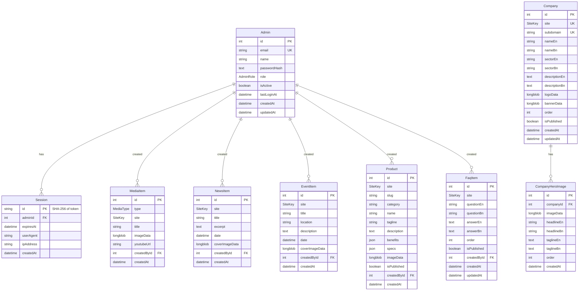

<!-- BEGIN:nextjs-agent-rules -->
# This is NOT the Next.js you know

This version has breaking changes — APIs, conventions, and file structure may all differ from your training data. Read the relevant guide in `node_modules/next/dist/docs/` before writing any code. Heed deprecation notices.
<!-- END:nextjs-agent-rules -->

---

# FHS Enterprise — Comprehensive Project Documentation

> **Superseded in parts — read [`CLAUDE.md`](CLAUDE.md) first.** `CLAUDE.md` is the maintained
> technical reference; [`OPERATIONS.md`](OPERATIONS.md) covers deployment and backups. This file was
> written earlier and a number of its statements are now **out of date**, notably: the legacy
> subsidiary components, types and CSS palettes now live under `legacy/subsidiaries/` (not in
> `src/`); `prisma.config.ts` is at the repo root; only the FAQ and gallery reads fall back to static
> data when the database is empty (all reads survive a database outage); the contact form now
> stores messages and `/admin/messages` and the dashboard show real data; rate limiting now exists
> (in memory); the placeholder phone number is no longer shown; and the SiteKey migration history was
> reconciled. Where this file and `CLAUDE.md` disagree, `CLAUDE.md` is correct.
>
> This document was the single source of truth for AI coding agents working on this project.
> Every fact below has been verified directly from the codebase. Sections marked **[UNVERIFIED]** need manual confirmation.

---

## Table of Contents

1. [Project Overview](#1-project-overview)
2. [Technology Stack](#2-technology-stack)
3. [Architecture & Directory Structure](#3-architecture--directory-structure)
4. [Database Schema & Relationships](#4-database-schema--relationships)
5. [Major Modules & Responsibilities](#5-major-modules--responsibilities)
6. [API Routes](#6-api-routes)
7. [Authentication & Authorization](#7-authentication--authorization)
8. [Coding Conventions & Patterns](#8-coding-conventions--patterns)
9. [Environment Configuration & Setup](#9-environment-configuration--setup)
10. [Build, Deployment & Migrations](#10-build-deployment--migrations)
11. [Business Rules & Known Limitations](#11-business-rules--known-limitations)
12. [Instructions for AI Coding Agents](#12-instructions-for-ai-coding-agents)

---

## 1. Project Overview

**Package name:** `fhs-enterprise`  
**Domain:** `fhsenterprise.com`  
**License:** Private / Proprietary

FHS Enterprise is a multi-tenant corporate website for **FHS Enterprise** (formerly branded "MR Group" in some admin UI surfaces), a diversified conglomerate based in **Fulbariya, Mymensingh, Bangladesh**. The company is founded by **Fakhrul Hasan Suton** (Proprietor).

The site presents a parent company landing page and supports **subsidiary company microsites** served via subdomains. Currently active subsidiaries:

| SiteKey              | Subsidiary Name                    | Subdomain / Route                     | Status        |
|----------------------|-------------------------------------|---------------------------------------|---------------|
| `FHS_ENTERPRISE`     | FHS Enterprise (parent)             | Root domain                           | Active        |
| `AUTO_RICE_MILL`     | M/s. Bangladesh Auto Rice Mill      | `auto-rice-mill.*` (+ aliases)        | Active (internal) |
| `VEHICLE_SOLUTIONS`  | Vehicle Solutions                    | Redirects to external domain          | External redirect |
| `DAILY_BAZAR`        | Daily Bazar — Modern Super Shop     | Redirects to external domain          | External redirect |

**Key business features:**
- Bilingual content (Bangla `bn` default, English `en`)
- Admin panel for managing companies, products, media, news, events, and FAQ
- Contact form with SMTP email delivery
- SEO: sitemaps, robots.txt, JSON-LD structured data, OpenGraph, Twitter Cards
- Multi-tenant subdomain routing with external redirect support

---

## 2. Technology Stack

| Layer            | Technology                                          | Version (verified)       |
|------------------|-----------------------------------------------------|--------------------------|
| Framework        | **Next.js** (App Router, Turbopack)                 | `16.2.10`                |
| UI Library       | React                                               | `19.2.4`                 |
| Language         | TypeScript (strict mode)                            | `^5`                     |
| Styling          | Tailwind CSS v4 (`@tailwindcss/postcss`)            | `^4`                     |
| Internationalization | next-intl                                       | `^4.13.2`                |
| ORM              | Prisma + `@prisma/adapter-mariadb`                  | `^7.8.0`                 |
| Database         | MySQL / MariaDB                                     | **[UNVERIFIED]** version |
| Email            | Nodemailer (SMTP)                                   | `^9.0.3`                 |
| Linting          | ESLint (`core-web-vitals` + TypeScript configs)     | `^9`                     |
| Build tool       | Turbopack (via Next.js 16)                          | Built-in                 |
| Auth             | Custom (scrypt + server-side sessions)              | No third-party library   |

### Path Alias

```json
// tsconfig.json
{ "@/*": "./src/*" }
```

All imports use `@/` to reference `src/`.

---

## 3. Architecture & Directory Structure

```
fhsenterprise/
├── prisma/
│   ├── schema.prisma           # Database schema (9 models, 3 enums)
│   ├── prisma.config.ts        # Prisma config (points to schema + migrations)
│   ├── migrations/             # 14 sequential Prisma migrations
│   ├── seed.ts                 # Interactive admin account seeder
│   └── seedCompanies.ts        # Seeds Company rows from static site data
├── messages/
│   ├── en.json                 # English UI strings (228 lines)
│   └── bn.json                 # Bangla UI strings (228 lines)
├── public/
│   ├── images/                 # Static images (companies, events, facilities, gallery, sustainability)
│   ├── logos/                  # Brand logos (SVG/PNG)
│   └── videos/                # Hero section videos (vehicle-solutions.mp4, daily-bazar.mp4, rice-mill.mp4)
├── docs/                       # Supporting documents (logos, photos — NOT code docs)
├── src/
│   ├── proxy.ts                # ⚠ Next.js 16 renamed middleware.ts → proxy.ts
│   ├── i18n/
│   │   ├── routing.ts          # Locale config: ["bn","en"], default "bn", prefix "always"
│   │   ├── request.ts          # Message catalog loader
│   │   └── navigation.ts      # Locale-aware Link, redirect, usePathname, useRouter
│   ├── app/
│   │   ├── layout.tsx          # Root layout (bare HTML passthrough)
│   │   ├── globals.css         # Tailwind v4 imports + brand color palettes (199 lines)
│   │   ├── icon.png            # Favicon
│   │   ├── not-found.tsx       # 404 page
│   │   ├── robots.ts           # robots.txt (disallows /admin/, /api/)
│   │   ├── sitemap.ts          # Dynamic sitemap with en/bn alternates
│   │   ├── [locale]/           # Public locale-prefixed pages
│   │   ├── admin/              # Admin panel (locale-free, at /admin)
│   │   └── api/                # API routes (image serving, contact form)
│   ├── components/
│   │   ├── layout/             # Header, Footer, LanguageSwitcher, PageHeader
│   │   ├── sections/           # Homepage sections (Hero, About, Companies, Stats, etc.)
│   │   ├── company/            # Per-subsidiary component trees (agro, filling, agromed, feed, agritech, mrlube, mahin, rahim)
│   │   ├── admin/              # Admin panel UI (AdminShell, Sidebar, Topbar, modals, forms)
│   │   ├── icons/              # ContactIcons, SocialIcon
│   │   └── navigation/         # Breadcrumbs
│   ├── data/
│   │   ├── site.ts             # Locale-keyed config loader
│   │   ├── site.en.ts          # Full English static content (351 lines)
│   │   ├── site.bn.ts          # Full Bangla static content (351 lines)
│   │   └── companies/          # Per-subsidiary static content (auto-rice-mill.ts, vehicle-solutions.ts)
│   ├── lib/                    # Shared server utilities
│   ├── types/                  # TypeScript interfaces & types
│   └── generated/prisma/       # Auto-generated Prisma client (DO NOT EDIT)
├── package.json
├── tsconfig.json
├── next.config.ts
├── postcss.config.mjs
├── eslint.config.mjs
├── AGENTS.md                   # This file
└── README.md                   # Developer documentation (382 lines)
```

### Routing Architecture

The app uses **Next.js App Router** with two parallel routing trees:

```
src/app/
├── [locale]/(main)/            # Public pages with Header + Footer wrapper
│   ├── page.tsx                # Homepage (hero, about, companies, stats, etc.)
│   ├── about/                  # history, founder, mission-vision, milestones, facilities, faq
│   ├── companies/              # Company explorer
│   ├── media/                  # news, events, gallery
│   ├── sustainability/         # environment, education, health, community-development
│   └── contact/                # Contact page with form
├── [locale]/companies/         # Subsidiary microsites (outside (main) layout)
│   ├── auto-rice-mill/         # Active internal subsidiary
│   └── vehicle-solutions/      # Redirects externally
└── admin/                      # Admin panel (NO locale prefix, own HTML shell)
    ├── login/                  # Login page
    └── (panel)/                # Auth-protected panel (layout calls requireAdmin())
        ├── page.tsx            # Dashboard
        ├── companies/          # Manage Company rows + hero images
        ├── products/           # Manage Product rows
        ├── media/              # Manage MediaItem, NewsItem, EventItem
        ├── faq/                # Manage FaqItem
        ├── messages/           # View contact form submissions
        └── settings/           # Account settings (change password)
```

### Multi-Tenant Subdomain Routing

Handled by `src/proxy.ts` (Next.js 16's replacement for `middleware.ts`):

1. **External redirects:** `vehiclesolutions.*` and `dailybazar.*` → external URLs (307)
2. **Internal subdomains:** `auto-rice-mill.*` (and aliases `autorice-mill`, `autorice`) → rewritten to `/[locale]/companies/auto-rice-mill/...`
3. **i18n fallthrough:** Non-subdomain requests processed by `next-intl` middleware
4. **Matcher:** `/((?!api|admin|_next|.*\\..*).*)` — excludes `/api`, `/admin`, `_next`, static files

In local dev: `<subdomain>.localhost:3000` (modern browsers resolve `*.localhost` to `127.0.0.1`).

---

## 4. Database Schema & Relationships

**Provider:** MySQL / MariaDB via `@prisma/adapter-mariadb`  
**Schema:** `prisma/schema.prisma` (299 lines)  
**Generated client:** `src/generated/prisma/` (gitignored — run `prisma generate`)

### Enums

| Enum         | Values                                                        |
|--------------|---------------------------------------------------------------|
| `AdminRole`  | `ADMIN`, `SUPER_ADMIN`                                        |
| `SiteKey`    | `FHS_ENTERPRISE`, `AUTO_RICE_MILL`, `VEHICLE_SOLUTIONS`, `DAILY_BAZAR` |
| `MediaType`  | `IMAGE`, `VIDEO`                                              |

### Models



### Key Design Decisions

- **Images stored as `LongBlob`** — No S3/object storage. All uploaded images stored directly in MySQL as byte columns. Served via API routes with cache-busting `?v=<timestamp>` query params.
- **YouTube videos stored as URLs** — Only the URL is stored; thumbnails derived from video ID at render time.
- **Bilingual columns** — Company and FAQ models use paired `...En` / `...Bn` columns. Product and News/Event models are single-language (admin enters text once, displayed on both locales).
- **Soft delete via `isActive`/`isPublished`** — Admin accounts use `isActive`; Company, Product, FaqItem use `isPublished`.
- **`createdBy` audit trail** — MediaItem, NewsItem, EventItem, Product, FaqItem track which admin created them (nullable FK, `onDelete: SetNull`).
- **Product slug uniqueness** — `@@unique([site, slug])` — unique per subsidiary, not globally.

### Naming Conventions

- **Table names:** PascalCase (Prisma default) — `Admin`, `Session`, `Company`, etc.
- **Column names:** camelCase — `passwordHash`, `createdAt`, `coverImageData`, etc.
- **Indexes:** Named by column(s) — `@@index([site])`, `@@index([companyId, order])`, etc.

### Migration History

14 sequential migrations under `prisma/migrations/`:

| Migration                               | Purpose                        |
|----------------------------------------|--------------------------------|
| `20260721055024_admin_auth`            | Admin + Session models         |
| `20260721073024_media_and_news`        | MediaItem + NewsItem           |
| `20260721105108_event_item`            | EventItem                      |
| `20260721120418_agri_tech_site_key`    | AGRI_TECH SiteKey addition     |
| `20260722055945_company_content`       | Company model                  |
| `20260722063828_company_hero_images`   | CompanyHeroImage model         |
| `20260722064036_remove_company_single_hero` | Schema refinement         |
| `20260722065059_company_hero_slide_text` | Hero slide headline/tagline  |
| `20260722081418_add_product`           | Product model                  |
| `20260722111050_mr_lube_site_key`      | MR_LUBE SiteKey addition       |
| `20260723055634_mahin_site_key`        | MAHIN SiteKey addition         |
| `20260723062410_rahim_site_key`        | RAHIM SiteKey addition         |
| `20260726120000_add_faq`              | FaqItem model                  |
| `20260727090000_rename_tech_lube_subdomains` | Subdomain renaming       |

> **Note:** Some SiteKey values from migrations (e.g., `AGRI_TECH`, `MR_LUBE`, `MAHIN`, `RAHIM`) have since been consolidated. The current schema has only 4 SiteKeys. The brand color palettes for these former subsidiaries still exist in `globals.css` as CSS custom properties.

---

## 5. Major Modules & Responsibilities

### Library Modules (`src/lib/`)

| File                    | Purpose                                                                 |
|-------------------------|-------------------------------------------------------------------------|
| `prisma.ts`             | Prisma client singleton (with `PrismaMariaDb` adapter, dev HMR-safe)   |
| `session.ts`            | Server-side session management (create, read, require, destroy)         |
| `password.ts`           | scrypt password hashing & constant-time verification                    |
| `companies.ts`          | `COMPANY_SUBDOMAINS` set, `companyUrl()`, `getRootDomain()`            |
| `sites.ts`              | `SITE_OPTIONS` array mapping SiteKey → display names for admin dropdowns |
| `publicContent.ts`      | Read-only DB data access for public pages (358 lines — companies, news, gallery, events, FAQ, hero slides, products). Falls back to static data. |
| `mailer.ts`             | Nodemailer transport + `sendContactEmail()`                             |
| `imageUpload.ts`        | Image validation (JPEG/PNG/WEBP/GIF, max 5MB) — shared client+server   |
| `youtube.ts`            | YouTube URL parsing, thumbnail/embed URL generation                     |
| `productCategories.ts`  | Per-site product category definitions                                   |
| `productJson.ts`        | JSON column parsers for `Product.benefits` / `Product.specs`            |
| `seo.ts`                | `buildPageMetadata()`, JSON-LD generators (Organization, Breadcrumb, FAQ, Person) |

### Data Layer (`src/data/`)

| File                       | Purpose                                                   |
|----------------------------|-----------------------------------------------------------|
| `site.ts`                  | Locale-keyed config loader (`getSiteConfig(locale)`)      |
| `site.en.ts`               | Full English static content (351 lines)                   |
| `site.bn.ts`               | Full Bangla static content (351 lines)                    |
| `companies/auto-rice-mill.ts` | Auto Rice Mill subsidiary content (en/bn)              |
| `companies/vehicle-solutions.ts` | Vehicle Solutions subsidiary content                |

### Type Definitions (`src/types/`)

| File           | Purpose                                                              |
|----------------|----------------------------------------------------------------------|
| `content.ts`   | Main site types: `SiteConfig`, `NavItem`, `HeroSlide`, `Company`, `Stat`, `ProductCategory`, `NewsItem`, `Milestone`, `FaqItem`, `FounderContent`, `SustainabilityPillar`, `ContactContent`, etc. (212 lines) |
| `company.ts`   | `CompanySiteContent`, `CompanyTheme` for subsidiary microsites       |
| `agro.ts`      | Agro subsidiary types                                                 |
| `agromed.ts`   | Agro Medicine subsidiary types                                        |
| `agritech.ts`  | Agri Technology subsidiary types                                       |
| `feed.ts`      | Feed subsidiary types                                                  |
| `filling.ts`   | Filling Station subsidiary types                                       |
| `mrlube.ts`    | MR Lube subsidiary types                                               |
| `mahin.ts`     | Mahin Enterprise subsidiary types                                      |
| `rahim.ts`     | Rahim Enterprise subsidiary types                                      |

### Component Structure (`src/components/`)

```
components/
├── layout/           # Header, Footer, LanguageSwitcher, PageHeader
├── sections/         # Homepage sections: Hero, About, Companies, WhyChooseUs, ProductCategories, Stats, VideoShowcase, Testimonials, CallToAction, LatestNews, Contact
│   ├── about/        # AboutTabs, FaqAccordion
│   ├── companies/    # CompanyExplorer
│   ├── contact/      # ContactForm
│   ├── media/        # GalleryTabs, MediaTabs
│   └── sustainability/ # PillarPage, SustainabilityTabs
├── company/          # Per-subsidiary component trees
│   ├── agro/         # AgroNavbar, AgroFooter, AgroProductExplorer, AgroHero, etc.
│   ├── filling/      # FillingNavbar, FillingHero, FillingServices, etc.
│   ├── agromed/      # AgroMedNavbar, AgroMedProductCard, etc.
│   ├── feed/         # FeedNavbar, FeedHeroSlider, FeedProductCard, etc.
│   ├── agritech/     # AgritechNavbar, AgritechHeroSlider, etc.
│   ├── mrlube/       # LubeNavbar, LubeHeroSlider, LubeProductCard, etc.
│   ├── mahin/        # MahinNavbar, MahinHeroSlider, MahinProductCard, etc.
│   ├── rahim/        # RahimNavbar, RahimHeroSlider, RahimProductCard, etc.
│   └── HeroSlideshow.tsx  # Shared hero slider component
├── admin/            # AdminShell, Sidebar, Topbar, LoginForm, Modal, BarChart, icons
│   ├── companies/    # CompaniesClient, CompanyCard, EditCompanyModal
│   ├── products/     # ProductsClient, ProductCard, CreateProductModal, EditProductModal, ViewProductModal
│   ├── media/        # MediaNewsClient, MediaCard, NewsCard, EventCard, Create*Modal, DeleteItemButton
│   └── faq/          # FaqClient, FaqCard, FaqFormModal
├── icons/            # ContactIcons, SocialIcon
└── navigation/       # Breadcrumbs
```

### Internationalization (`src/i18n/`)

| File           | Purpose                                                          |
|----------------|------------------------------------------------------------------|
| `routing.ts`   | Defines locales `["bn", "en"]`, default `"bn"`, prefix `"always"`, detection `false` |
| `request.ts`   | Loads message catalogs from `messages/{locale}.json`             |
| `navigation.ts`| Exports locale-aware `Link`, `redirect`, `usePathname`, `useRouter`, `getPathname` |

> **Important:** `localeDetection: false` means the site always lands first-time visitors on Bangla (`/bn`), ignoring the browser's `Accept-Language` header. Users switch manually via the language switcher.

---

## 6. API Routes

All API routes are under `src/app/api/`. No REST API authentication is used — image-serving routes are public, and the contact route is also public.

| Route                                   | Method | Purpose                                           | Auth     |
|-----------------------------------------|--------|---------------------------------------------------|----------|
| `/api/contact`                          | POST   | Submit contact form → sends email via SMTP         | Public   |
| `/api/companies/[id]/logo`              | GET    | Serve Company logo bytes from DB                   | Public   |
| `/api/companies/[id]/banner`            | GET    | Serve Company banner bytes from DB                 | Public   |
| `/api/companies/hero-images/[id]`       | GET    | Serve CompanyHeroImage bytes from DB               | Public   |
| `/api/media/[id]/image`                 | GET    | Serve MediaItem image bytes from DB                | Public   |
| `/api/news/[id]/image`                  | GET    | Serve NewsItem cover image bytes from DB           | Public   |
| `/api/events/[id]/image`                | GET    | Serve EventItem cover image bytes from DB          | Public   |
| `/api/products/[id]/image`              | GET    | Serve Product image bytes from DB                  | Public   |

### Contact Form Endpoint (`POST /api/contact`)

**Request body (JSON):**
```json
{
  "name": "string (required)",
  "email": "string (required, validated)",
  "phone": "string (optional)",
  "subject": "string (required)",
  "message": "string (required)"
}
```

**Responses:**
- `200 { success: true }` — Email sent
- `400 { error: "..." }` — Validation failure
- `500 { error: "..." }` — SMTP failure

### Admin Server Actions

Admin CRUD is implemented via **Server Actions** (not REST routes), located in:

| File                                       | Actions                                       |
|--------------------------------------------|-----------------------------------------------|
| `src/app/admin/actions.ts`                 | `loginAction`, `logoutAction`, `changePasswordAction` |
| `src/app/admin/(panel)/companies/actions.ts`| Company + CompanyHeroImage CRUD               |
| `src/app/admin/(panel)/media/actions.ts`   | MediaItem, NewsItem, EventItem CRUD           |
| `src/app/admin/(panel)/products/actions.ts`| Product CRUD                                  |
| `src/app/admin/(panel)/faq/actions.ts`     | FaqItem CRUD                                  |

---

## 7. Authentication & Authorization

### Overview

**Fully custom implementation — no NextAuth, Clerk, or any third-party auth library.**

### Password Security (`src/lib/password.ts`)

- **Algorithm:** Node.js built-in `scrypt` (N=32768, r=8, p=1)
- **Key length:** 64 bytes
- **Salt:** 16 bytes (random per hash)
- **Storage format:** `scrypt$<N>$<r>$<p>$<salt-base64>$<hash-base64>`
- **Unicode normalization:** NFKC (for Bangla input compatibility)
- **Verification:** Constant-time comparison via `timingSafeEqual`
- **Memory limit:** 96 MB (`maxmem`)

### Session Management (`src/lib/session.ts`)

- **Cookie name:** `mr_admin_session`
- **Duration:** 7 days
- **Token generation:** 32 bytes from `crypto.randomBytes`, encoded as `base64url`
- **Storage:** DB stores `SHA-256(token)` — leaked DB cannot replay sessions
- **Cookie flags:** `httpOnly`, `secure` (prod only), `sameSite: "lax"`, `path: "/"`
- **Session reading:** Wrapped in React `cache()` for per-request deduplication
- **Force logout:** `destroyAllSessionsFor(adminId)` on password change

### Auth Boundary

```
src/app/admin/(panel)/layout.tsx  →  calls requireAdmin()
```

If `requireAdmin()` finds no valid session, it `redirect("/admin/login")`.

### Timing Attack Prevention

The `loginAction` always hashes against a dummy value when the account doesn't exist, so response time doesn't reveal valid email addresses:

```typescript
const storedHash = admin?.passwordHash ?? "scrypt$32768$8$1$<dummy-salt>$<dummy-hash>";
```

### Authorization Model

- Two roles defined in schema: `ADMIN` and `SUPER_ADMIN`
- **Currently no role-based access control is enforced** — all admins have full access. The `role` column exists for future fine-grained permissions.
- Soft-disabled admins (`isActive: false`) cannot log in.

---

## 8. Coding Conventions & Patterns

### General

- **TypeScript strict mode** enabled in `tsconfig.json`
- **Module resolution:** `bundler`
- **Target:** ES2017
- **Path alias:** `@/*` → `./src/*`
- All imports use `@/` prefix

### Next.js 16 Specifics

> ⚠️ **CRITICAL:** This project runs **Next.js 16**, which has breaking changes from earlier versions. Always consult `node_modules/next/dist/docs/` before making changes.

- **`proxy.ts` replaces `middleware.ts`** — The exported function is `proxy`, not `middleware`
- **`proxy.ts` config export** — Uses `config.matcher`, same pattern as old middleware
- **Server Actions body size limit** — Set to `6mb` in `next.config.ts`
- **Image local patterns** — Query strings require explicit allowlisting via `images.localPatterns`
- **Generated Prisma client** — Output to `src/generated/prisma/` (gitignored)

### Content Architecture: Static + DB Hybrid

Public pages use `src/lib/publicContent.ts`, which:
1. Queries the database for dynamic content (news, gallery, events, companies, FAQ, products)
2. **Falls back to static data** from `src/data/site.*.ts` when the DB returns no rows
3. This means pages never render empty, even before an admin adds any content

### Component Patterns

- **Server Components** by default — no `"use client"` unless needed
- **Client Components** for interactive UI: forms, modals, tabs, accordions, sliders
- **Server Actions** (`"use server"`) for all admin CRUD — no REST endpoints for mutations
- **React `useActionState`** for form state management in admin forms
- **Per-subsidiary component trees** — Each subsidiary has its own branded set of components under `components/company/<name>/` with its own navbar, footer, hero, sections, etc.

### Styling Conventions

- **Tailwind CSS v4** with `@import "tailwindcss"` syntax (not the old `@tailwind` directives)
- **Brand color palettes** defined as CSS custom properties in `globals.css` under `@theme` blocks
- **Per-subsidiary theming:** Each subsidiary has its own color namespace (`agro-*`, `fuel-*`, `vet-*`, `feed-*`, `agri-*`, `lube-*`, `mahin-*`, `rahim-*`)
- **Primary brand colors:** `brand-blue` (#0045a0) and `brand-green` (#097b33)
- **Fonts:** Geist Sans, Geist Mono, Noto Sans Bengali (for Bangla locale), plus per-subsidiary display fonts

### Data & Type Conventions

- **Bilingual content models** use paired `...En` / `...Bn` columns (Company, FaqItem)
- **Single-language content models** (NewsItem, EventItem, Product) display the same text in both locales
- **Image bytes** stored in DB as `Bytes @db.LongBlob` — served via API routes
- **JSON columns** (`Product.benefits`, `Product.specs`) parsed with safe runtime validators in `src/lib/productJson.ts`
- **Date serialization:** All dates crossing the Server/Client boundary are serialized as ISO strings

### File Naming

- **Components:** PascalCase (e.g., `CompanyExplorer.tsx`, `AdminShell.tsx`)
- **Lib/data/type files:** camelCase (e.g., `publicContent.ts`, `imageUpload.ts`)
- **Route files:** `page.tsx`, `layout.tsx`, `route.ts`, `actions.ts`
- **CSS:** `globals.css` only (Tailwind utility classes used everywhere else)

---

## 9. Environment Configuration & Setup

### Environment Variables (`.env.example`)

| Variable                 | Required      | Default               | Purpose                                     |
|--------------------------|---------------|-----------------------|---------------------------------------------|
| `DATABASE_URL`           | **Yes**       | —                     | MySQL connection string                      |
| `NEXT_PUBLIC_ROOT_DOMAIN`| Optional      | `localhost:3000`      | Root domain for subdomain routing            |
| `SMTP_HOST`              | For email     | —                     | SMTP server hostname                         |
| `SMTP_PORT`              | For email     | —                     | SMTP port (465 = SSL, 587 = STARTTLS)        |
| `SMTP_USER`              | For email     | —                     | SMTP username                                |
| `SMTP_PASSWORD`          | For email     | —                     | SMTP password                                |
| `SMTP_FROM`              | Optional      | `SMTP_USER`           | From header for contact emails               |
| `CONTACT_EMAIL_TO`       | Optional      | `SMTP_USER`           | Delivery address for contact form            |

> Admin credentials are **never** in `.env`. The seed script prompts interactively.

### Setup Commands

```bash
# 1. Install dependencies
npm install

# 2. Copy and configure environment
cp .env.example .env
# Edit .env with real DATABASE_URL and optional SMTP credentials

# 3. Generate Prisma client
npm run prisma:generate

# 4. Run database migrations
npm run prisma:migrate

# 5. Create first admin account (interactive prompts for name, email, password)
npm run db:seed

# 6. Seed company data from static files
npm run db:seed:companies

# 7. Start development server
npm run dev
```

### NPM Scripts

| Script              | Command                                                      | Purpose                        |
|---------------------|--------------------------------------------------------------|--------------------------------|
| `dev`               | `next dev`                                                   | Start dev server (Turbopack)   |
| `build`             | `next build`                                                 | Production build               |
| `start`             | `next start`                                                 | Start production server        |
| `lint`              | `eslint`                                                     | Run ESLint                     |
| `prisma:migrate`    | `prisma migrate dev`                                         | Run Prisma migrations (dev)    |
| `prisma:generate`   | `prisma generate`                                            | Generate Prisma client         |
| `prisma:push`       | `prisma db push`                                             | Push schema without migration  |
| `prisma:studio`     | `prisma studio`                                              | Open Prisma Studio GUI         |
| `update`            | `prisma migrate dev && prisma generate && tsx prisma/seedCompanies.ts` | Full DB update pipeline |
| `db:seed`           | `tsx prisma/seed.ts`                                         | Create admin account (interactive) |
| `db:seed:companies` | `tsx prisma/seedCompanies.ts`                                | Seed Company rows from static data |

---

## 10. Build, Deployment & Migrations

### Build

```bash
npm run build   # Standard Next.js 16 production build
npm run start   # Serve the built application
```

### Deployment

No deployment configuration files exist (no `vercel.json`, `docker-compose.yml`, `.github/workflows/`, `Dockerfile`, etc.).

The README states it can be deployed as a "standard Next.js 16 application" on Vercel, VPS, or container platforms.

**[UNVERIFIED]:** Actual deployment target and process.

### Migrations

Prisma handles database migrations:

```bash
# Development: create and apply migrations
npm run prisma:migrate

# Production: apply pending migrations
npx prisma migrate deploy

# Emergency: push schema without migration history
npm run prisma:push
```

### SEO

- **`robots.ts`** — Allows all crawlers on `/`, disallows `/admin/` and `/api/`
- **`sitemap.ts`** — Dynamic sitemap with all public routes, en/bn alternates, priority scoring
- **`src/lib/seo.ts`** — `buildPageMetadata()` generates canonical URLs, hreflang alternates, OpenGraph, Twitter Cards, geo tags; JSON-LD generators for Organization, Breadcrumb, FAQ, and Person schemas

---

## 11. Business Rules & Known Limitations

### Business Rules

1. **Default locale is Bangla (`bn`)** — First-time visitors always land on `/bn`, regardless of browser language
2. **Vehicle Solutions and Daily Bazar redirect externally** — These subsidiaries have their own separate deployments at `vehiclesolutions.fhsenterprise.com` and `dailybazar.fhsenterprise.com`
3. **Only Auto Rice Mill** is an active internal subsidiary with a full subdomain microsite
4. **Admin panel is locale-free** — Lives at `/admin` (no `/bn/admin` or `/en/admin`)
5. **Contact form requires SMTP** — If SMTP env vars aren't set, the contact form will fail with an error
6. **Image size limit: 5MB** — Enforced client-side and server-side in `imageUpload.ts`; Server Actions body limit is 6MB in `next.config.ts`
7. **No individual news/event detail pages** — All news links to `/media/news` (the list page)
8. **Product slugs are unique per-site** — Two subsidiaries can have products with the same slug

### Known Limitations

1. **No object storage** — All images stored as MySQL `LongBlob`. This works for the current scale but may need migration to S3/R2 if image volumes grow significantly.
2. **No test suite** — No test files, test framework, or test configuration exist.
3. **No CI/CD pipeline** — No GitHub Actions, Vercel config, or other automation.
4. **No rate limiting** — Contact form and login have no rate limiting or CAPTCHA.
5. **No RBAC enforcement** — `ADMIN` and `SUPER_ADMIN` roles exist in schema but both have identical access.
6. **Legacy subsidiary components** — Components for 8+ subsidiaries (agro, filling, agromed, feed, agritech, mrlube, mahin, rahim) exist in `src/components/company/` and their CSS palettes in `globals.css`, but only Auto Rice Mill is currently active. These are remnants from the "MR Group" era.
7. **No expired session cleanup automation** — `deleteExpiredSessions()` exists but is not called on any schedule.
8. **Dashboard shows static demo data** — The admin dashboard page displays placeholder statistics, not live data.
9. **Messages page is a scaffold** — `/admin/messages` exists but is not wired to any data source for viewing contact form submissions.
10. **Product bilingual support limited** — Products have no `...En`/`...Bn` column pairs, so admin-entered text appears identically in both locales.

---

## 12. Instructions for AI Coding Agents

### Before You Start

1. **Read Next.js 16 docs** — This project uses Next.js 16 which has breaking changes. Check `node_modules/next/dist/docs/` before writing any code.
2. **`proxy.ts`, not `middleware.ts`** — Next.js 16 renamed the middleware file. The exported function is `proxy`, not `middleware`.
3. **`src/generated/prisma/` is auto-generated** — Never edit files in this directory. Run `npm run prisma:generate` after schema changes.

### Do Not

- **Do not modify `.env`** or expose any secrets (passwords, API keys, tokens)
- **Do not modify production data** or run destructive database operations
- **Do not bypass authentication** or access control checks
- **Do not introduce new dependencies** without explicit user approval
- **Do not delete existing components** for legacy subsidiaries (agro, filling, etc.) — they may be reactivated
- **Do not edit `src/generated/prisma/`** — always regenerate via Prisma CLI

### When Adding New Features

1. **Follow the static + DB hybrid pattern** — New public content should query the DB via `src/lib/publicContent.ts` and fall back to static data in `src/data/site.*.ts`
2. **Server Actions for mutations** — Use `"use server"` actions, not REST endpoints, for admin panel CRUD
3. **Bilingual content** — If the model needs both languages, add paired `...En` / `...Bn` columns
4. **Image storage** — Use the existing `LongBlob` pattern (see `imageUpload.ts` for validation)
5. **SEO** — Use `buildPageMetadata()` from `src/lib/seo.ts` for page metadata; add JSON-LD where appropriate
6. **Locale-aware links** — Use `Link` from `@/i18n/navigation`, not `next/link`
7. **Admin pages** — Place under `src/app/admin/(panel)/` to inherit the auth boundary
8. **Types** — Define new types in `src/types/` and keep them in sync with Prisma models

### When Modifying the Database

1. Edit `prisma/schema.prisma`
2. Run `npm run prisma:migrate` to create a migration
3. Run `npm run prisma:generate` to regenerate the client
4. Update `src/lib/publicContent.ts` if the new model serves public content
5. Update `src/lib/sites.ts` and `src/lib/productCategories.ts` if adding new SiteKeys or categories

### Key Files to Understand

| File                          | Why It Matters                                           |
|-------------------------------|----------------------------------------------------------|
| `src/proxy.ts`                | All request routing starts here                          |
| `src/lib/publicContent.ts`    | Bridge between DB and public pages (358 lines)           |
| `src/data/site.en.ts`         | Authoritative English content (351 lines)                |
| `src/data/site.bn.ts`         | Authoritative Bangla content (351 lines)                 |
| `src/types/content.ts`        | Core type definitions (212 lines)                        |
| `src/lib/session.ts`          | Session management — understand before touching auth     |
| `prisma/schema.prisma`        | Database schema — understand before any data changes     |
| `src/app/globals.css`         | Brand palettes — understand before styling changes       |
| `next.config.ts`              | Framework config — image patterns, redirects, body limits|

### Subsidiary Component Pattern

Each subsidiary follows a consistent structure:

```
components/company/<name>/
├── <Name>Navbar.tsx
├── <Name>Footer.tsx
├── <Name>Icon.tsx
├── <Name>PageHeader.tsx
├── <Name>HeroSlider.tsx (or custom hero)
├── <Name>ProductCard.tsx (if applicable)
└── sections/
    ├── <Name>Hero.tsx
    ├── <Name>Gallery.tsx
    ├── <Name>Stats.tsx
    ├── <Name>Cta.tsx
    └── ... (varies per subsidiary)
```

Each has a matching type definition in `src/types/<name>.ts`, a color palette in `globals.css`, and a display font variable.

---

## Appendix: Files in This Project Still Requiring Verification

| Item                              | What To Check                                    |
|-----------------------------------|--------------------------------------------------|
| MySQL/MariaDB server version      | Run `SELECT VERSION()` on the database           |
| Actual deployment infrastructure  | Where is the production site hosted?             |
| `docs/` folder contents           | Contains images (logos, photos), not code docs   |
| `temp_videos/` folder             | Working directory for video generation — likely safe to clean up |
| `crop.py`, `crop_better.py`       | Python scripts in root — likely one-off image tools |
| `generate_svg_logos.js`           | One-off script for generating SVG logos           |
| `insert.sql`, `query.js`, `query.ts` | One-off DB scripts in root — likely development artifacts |
| `CLAUDE.md`                       | Minimal file (12 bytes) — may need updating       |
| `__pycache__/`                    | Python bytecode cache in root — can be cleaned up |
